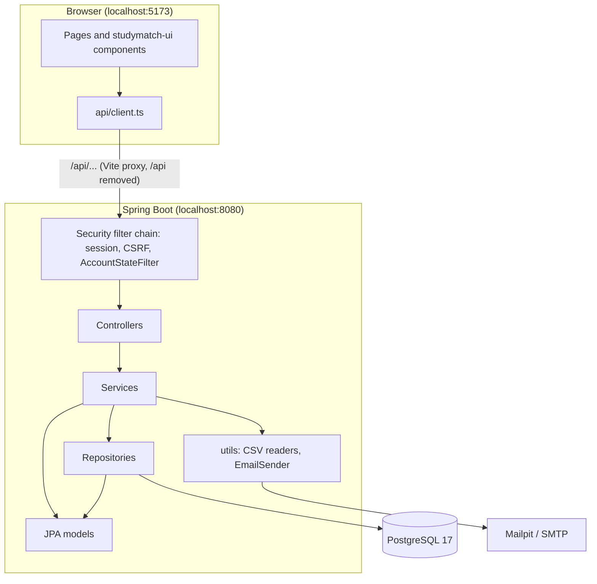
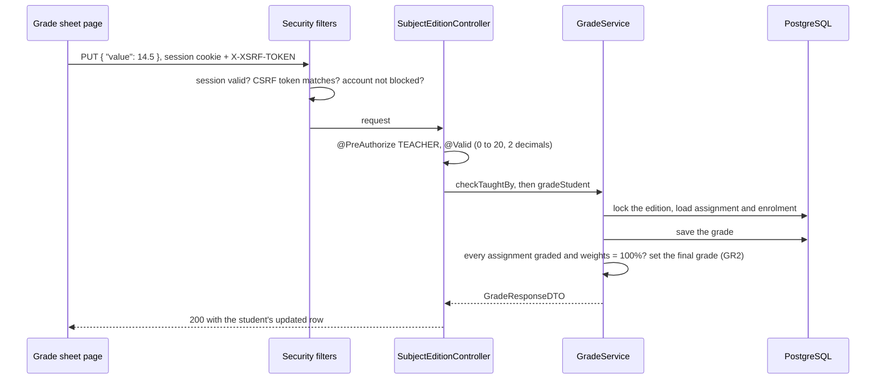

# Architecture

StudyMatch is two applications and a database. The frontend is a React single-page app, the backend is a Spring Boot REST API, and PostgreSQL stores everything. Locally, PostgreSQL and Mailpit (a fake mail server) run in Docker; the backend and frontend run on your machine.

## The layers

| Layer | Where | What it does | What it doesn't do |
| --- | --- | --- | --- |
| Pages and components | `frontend/src/pages`, `frontend/src/studymatch-ui` | Show data and forms, translate error codes into text | Business rules. A form can check a field early for a quicker message, but the backend checks it again |
| API client | `frontend/src/api` | One function per endpoint. `client.ts` adds the `/api` prefix and the CSRF header, and turns an error response into a `BackendError` | Decide anything from the data |
| Security filter chain | `backend/.../security` | Checks the session, the CSRF token and the account's state before any controller runs | Role checks per endpoint (those are on the controllers) |
| Controllers | `backend/.../controllers` | Map a URL to a service call, check the role with `@PreAuthorize`, validate the body with `@Valid`, pick the HTTP status | Business rules, database access |
| Services | `backend/.../services` | The business rules and transactions. One service per entity | Use another entity's repository (they call that entity's service instead) |
| Repositories | `backend/.../repositories` | Spring Data interfaces, mostly derived queries like `findBySubjectEditionId` | Logic |
| Models | `backend/.../models` | JPA entities. The rules about a single object live here (see below) | Know about HTTP or other services |
| DTOs | `backend/.../dtos` | Records for what comes in (with validation annotations) and what goes out. Entities never leave the backend | Logic beyond building themselves from a model |

The frontend never talks to the database and the controllers never talk to repositories. Every request goes through the same path, which is why the integration tests can test a whole use case with one HTTP call.

## Where the business rules live

There are two places. Which one depends on whether the rule needs the database.

**Rules about one object live in the model**, usually in its constructor or setter, and they throw a `StudyMatchException` with an error code. A `StudyRoom` can't start in the past or end before it starts. A `GroupingRule` needs groups of at least 2, with the optimal size between the minimum and the maximum. A `Rating` needs confirmed attendance and has to come within 7 days of the session ending. `PersonalityProfile.fromAnswers` turns the 15 answers into the four scores. These rules hold whoever creates the object, and they're tested with plain JUnit, without Spring.

**Rules that need the database or several objects live in the service.** Is this assignment name already taken in the edition? Do the weights go over 100%? Has the student already passed this subject? Is every assignment graded, so the final grade can be set?

Controllers and the frontend have no business rules. The only check a controller makes itself is the role, through `@PreAuthorize`. "Only the teachers of this edition" is a service method (`SubjectEditionService.checkTaughtBy`) that the controller calls first.

## One request, start to finish

A teacher grading a student (`PUT /subject-editions/{id}/assignments/{assignmentId}/grades/{studentNumber}`) goes through every layer:

If anything fails on the way, a `StudyMatchException` goes up to `GlobalExceptionHandler`, which answers with the code's HTTP status and `{ "code": "STUDENT_NOT_ENROLLED", "params": { "number": 50007 } }`. The frontend shows `errors.STUDENT_NOT_ENROLLED` from `en.json` or `pt.json`. More on error codes in [conventions.md](conventions.md#error-codes).

## How the frontend talks to the backend

The frontend calls `/api/...` on its own origin, and Vite's dev server forwards those calls to `localhost:8080` without the `/api` part. To the browser, everything comes from `localhost:5173`, so there's no CORS in development. CORS is still configured on the backend for the frontend URL (`studymatch.frontend-url`) for when they're served from different places.

### Login and the session

We use a server-side session, not JWT. `POST /users/login` checks the institutional email and the BCrypt hash, then stores the login in the HTTP session. The browser keeps the session cookie (`JSESSIONID`, HttpOnly, SameSite=Lax) and sends it with every request; the frontend's JavaScript never sees it. The session id changes on login and on password change, so an id someone saw before can't be reused. `POST /users/logout` ends the session (204).

We picked sessions because the browser handles the cookie and logging out really ends the session on the server. A JWT stays valid until it expires and has to be stored somewhere JavaScript can read it.

### CSRF

A session cookie is sent automatically, so another website could make your browser send a POST to StudyMatch with your session. To stop that, the backend uses Spring Security's `csrf.spa()`: it sets an `XSRF-TOKEN` cookie that JavaScript can read, and every POST, PUT, PATCH or DELETE has to send the same value back in the `X-XSRF-TOKEN` header. `client.ts` does that on every request. Another site can make the browser send our cookies, but it can't read them, so it can't fill in the header. A missing or wrong token gets 403 `CSRF_TOKEN_INVALID`.

Swagger UI does the same thing (`springdoc.swagger-ui.csrf.enabled=true`), so "Try it out" works after logging in through `POST /users/login` on the same page.

### Account state

`AccountStateFilter` runs after Spring Security has identified the user, on every request:

| Situation | What the user can still do | Anything else gets |
| --- | --- | --- |
| Account blocked | nothing, the session is ended | 403 `ACCOUNT_BLOCKED` |
| First login, password not changed yet | `GET /users/me`, `PUT /users/change-password` | 403 `PASSWORD_CHANGE_REQUIRED` |
| Student without this year's personality test (GR1) | the two above and `POST /students/personality-test` | 403 `PERSONALITY_TEST_REQUIRED` |

`GET /users/me` returns `mustChangePassword` and `personalityTestRequired`, and the frontend uses them to send the user to the right page.

Not logged in at all gets 401 `UNAUTHENTICATED`, except for `POST /users/login`, `/users/forgot-password`, `/users/reset-password` and the API docs. Errors from the security layer are written by `SecurityErrorWriter` in the same JSON shape as every other error.

## Persistence

We use JPA with Hibernate, and `ddl-auto=update` creates and extends the tables from the models when the backend starts. It never drops or renames columns, so after renaming a field the old column stays behind. `docker compose down -v` gives you a clean database.

The four kinds of user use `JOINED` inheritance: a `users` table with what every account has, and `admin`, `staff`, `teacher` and `student` tables with the rest.

`open-in-view` is off, so lazy relations only load inside a service's transaction. A controller that touches one gets an exception instead of a hidden extra query. That's one reason services return DTOs and not entities.

Enrolling students, creating an assignment and grading lock the subject edition row (`SubjectEditionRepository.findLockedById`, `PESSIMISTIC_WRITE`) until the transaction ends. Without the lock, two Staff could enrol the same student at the same moment, or two grades for the same student could both miss setting the final grade. Unique columns (emails, codes, names) catch what's left: if two requests pass the "already exists?" check at once, the second insert fails and the service turns that into the same `..._ALREADY_EXISTS` code.

`data.sql` runs after Hibernate on every start and skips rows that already exist. The `test` profile turns it off, because the tests create their own data.

## Email

`EmailSender` sends through Spring Mail: account credentials, new one-time passwords and password reset codes. Locally it goes to Mailpit (http://localhost:8025); the `MAIL_*` variables point it at a real SMTP server. When an account is created, the account is committed before the email is sent, so a mail failure never undoes it. The response says `emailSent: false` and Staff can resend the credentials later.
