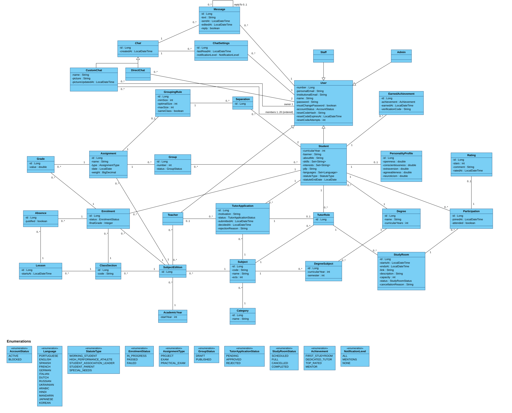

# Domain

## Class diagram

The diagram shows the entities and how they relate. This page covers what it can't: how the numbers on a student's profile are worked out, what happens when there's no data yet, and the rules the use cases depend on. The use cases themselves are the GitHub issues, and the business rules they share are numbered GR1 to GR11. Where a rule belongs to a use case that isn't built yet, the issue number is next to it.

## The concepts

| Concept | What it is |
| --- | --- |
| User | Anyone who logs in: Admin, Staff, Teacher or Student. The login is the institutional email (`<number>@students.<domain>` for students, `<username>@<domain>` for everyone else). The personal email is where credentials and reset codes go. |
| Degree | A degree programme, with how many curricular years it has. |
| Category | A group of related subjects (Programming, Mathematics...). Students get a level per category. |
| Subject | A course unit: unique code, name, ECTS and one category. It can belong to several degrees, each time with its own curricular year and semester (`DegreeSubject`). |
| Academic year | Just its start year: 2026 means 2026/2027. |
| Subject edition | A subject taught in one academic year, with its teachers and its classes (`ClassSection`, like T1 or PL2). |
| Enrolment | A student in one class of one edition. It ends with a final grade (0 to 20) and the status Passed or Failed. Before that it's In progress. |
| Assignment | Something graded in an edition: project, exam and so on, with a date and a weight. Group work also has a `GroupingRule` (min, optimal and max group size, same class or not, and pairs of students to keep apart). |
| Grade | One student's grade (0 to 20, two decimals) on one assignment. |
| Lesson, Absence | A lesson of a class at a given start time. Only absences are stored, each one justified or not. |
| Personality profile | Four scores from the yearly personality test. |
| Special statute | Worker-student, athlete and so on, with an end date. A student has one at most, with no history. |
| Tutor application, Tutor role | A student asks to tutor a subject they passed; the teacher approves it and the student gets the tutor role for that subject. |
| StudyRoom, Participation, Rating | An online session a tutor hosts for one subject, the students who join it (and whether they attended), and their 1 to 5 star ratings. |
| Earned achievement | An achievement a tutor earned, with the date and a verification code for the certificate. |
| Group | A group of students for one group assignment. |
| Chat, Message, Chat settings | A DM between two users (more kinds of chat come with their issues), the messages in it, and each member's own settings for it: when they last read it and their notification level. |

## The student profile

Anyone logged in can open a student's profile (`GET /students/{number}/profile`), but what they see depends on who they are.

Everyone sees the public part: name, banner, photo, about me, skills, interests, languages, a badge per subject they tutor (with their average stars and how many ratings it's from), and their achievements.

The student themselves, Staff, and the teachers of any edition the student is enrolled in also see the private part: institutional email, degree, curricular year, personality profile, attendance, and whether the student has any academic history yet.

Staff's student record (`GET /students/{number}`) adds the average grade, the category levels, every enrolment, and the special statute.

The self-declared fields (about me, skills, interests, banner) are only for display and never used to form groups. Languages are the exception, since every group must share one (GR4).

## Personality test

Every student takes it on their first login, right after changing their password, and once every academic year (GR1). Until they do, they can only see who they are (`GET /users/me`), change their password and take the test; everything else answers `PERSONALITY_TEST_REQUIRED`. Starting a new academic year deletes every profile, so everyone takes it again, including students who are logged in at that moment (their next request gets the same answer).

The test is the Mini-IPIP (Donnellan, Oswald, Baird & Lucas, 2006): 20 statements, four for each Big Five trait, asked in the paper's order with the item wording from the IPIP key (ipip.ori.org/MiniIPIPKey.htm). Students describe themselves as they generally are now, from 1 (very inaccurate) to 5 (very accurate). Eleven statements are keyed the other way ("I don't talk a lot" counts against extraversion), so their answer is flipped to 6 minus the answer. Every item weighs the same: a trait is the average of its four answers, scaled to 0 to 1, so it has 17 possible values. The Mini-IPIP calls openness Intellect/Imagination; we keep the name openness. Neuroticism is kept as measured, so a higher score means more neurotic. The code is in `PersonalityProfile.fromAnswers`.

There's no validated Portuguese Mini-IPIP. The Portuguese statements come from João P. Oliveira's translation of the 50-item IPIP markers (ipip.ori.org/Portuguese50-itemBigFiveFactorMarkers.htm), which has all 20 items. We changed two things: the spelling follows the current agreement ("abstratas"), and "Get upset easily" is "Fico perturbado com facilidade", because the translation says "preocupado" (worried), which is a different thing.

Donnellan, M. B., Oswald, F. L., Baird, B. M., & Lucas, R. E. (2006). The Mini-IPIP scales: Tiny-yet-effective measures of the Big Five factors of personality. *Psychological Assessment, 18*(2), 192-203.

## Grades, category levels and the average

A teacher grades each assignment from 0 to 20 with up to two decimals. The final grade is set by itself once two things are true: the edition's assignment weights add up to 100%, and the student has a grade on every assignment. It's the weighted average rounded half up to a whole number, so 9.5 becomes 10 (GR2). From 10 the enrolment is Passed, below 10 it's Failed. Grading again recalculates it. If the weights don't reach 100% yet, the grade is saved, there's no final grade, and the grade sheet says `weightsComplete: false` so the page can warn about it.

Two numbers come from the finished enrolments (the ones with a final grade, passed or failed). A category level is the plain average of the final grades in that category's subjects; a failed attempt counts, and so does the later pass of the same subject. The average grade uses every final grade weighted by ECTS, so a 10 ECTS subject counts twice as much as a 5 ECTS one.

Neither is stored; they're calculated every time from the enrolments (`EnrolmentService`), so a new final grade shows up straight away.

When there's no data, there's no number. A category the student hasn't finished anything in has no level and doesn't appear in the list; a teacher's student list shows the level for that subject's category as empty. A student with no finished subjects has no average grade. We never put a 0 or a guess in their place, because a 0 would look like a very bad student.

## Cold start

A first-year student has no grades and no attendance yet, so the personality test is what we know about them from day one. That's why it's mandatory before anything else (GR1).

Generating groups (#57) will use the best evidence each student has, in this order (GR6):

1. their grades and attendance in the assignment's category
2. if there are none, their grades and attendance overall
3. if there are none either, the personality profile only

So the personality test carries the whole decision for a new student. It counts less as their grades and attendance build up, because those take its place. On the profile, `hasAcademicHistory` turns true with the student's first enrolment, while the category levels and the average stay empty until a subject is finished. The full matching strategy is in [group-matching.md](group-matching.md).

## Attendance

Attendance is worked out per enrolment: the lessons stored for the student's class, minus their unjustified absences, divided by the lessons. Every stored lesson counts, so only lessons that already happened get stored. A justified absence counts as attended. The profile's overall attendance adds up every enrolment the same way.

Staff registers it one lesson at a time: the class plus the date and start time, since a class can have more than one lesson a day. Only the absent students are sent, each one justified or not, and everyone else was present. Saving the same lesson again corrects it. A lesson that hasn't started yet is refused (`LESSON_IN_FUTURE`) because it would already count as held, and the seconds are dropped, so 9:00 and 9:00:30 are the same lesson. Only editions of the current year take new records.

A lesson saved with the wrong time or class can't be fixed by saving it again with no absences, because the lesson itself still counts as held for the whole class. Staff deletes it instead, picking it by class and start time like the sheet, and its absences go with it. Deleting a lesson that was never saved gives `NOT_FOUND`.

Before the first lesson there's nothing to measure, so attendance is empty, not 100%. A student with an active special statute has no attendance at all: teachers see "not applicable" and never the statute type (GR7). Only Staff sees the type. Staff gives a statute with just the type and the end date, since it starts the day it's added, and giving another one replaces the current one, even of the same type. A statute ends by itself after its end date, which can't be in the past when it's given (today is fine, it's still active that day). Staff can also end it early, which removes it, and ending one for a student who has none gives `STUDENT_HAS_NO_STATUTE`.

## The current academic year

The newest registered academic year is the current one. There's no flag to keep in sync, so there can only ever be one. Starting a new year adds the next one, and it becomes current because it's now the newest.

Staff never types the year. The next one is the current start year plus one, and when there's no year at all it's the one today falls in: September onwards is this calendar year, January to August the previous one. Before confirming, Staff sees that year and every enrolment of the current year that still has no final grade (`GET /academic-years/next`). That list is only a warning, so they can go ahead anyway.

The confirmation sends back the year Staff saw. If it's no longer the next one, because the same confirmation was sent twice or another Staff member started it first, the answer is `ACADEMIC_YEAR_NOT_NEXT` and nothing changes. Without that check a second confirmation would start the year after as well. Two confirmations at the same moment both pass the check, so the second one is stopped by the year's primary key and gets the same code. Starting the year deletes every personality profile in the same transaction (GR1). Statutes don't need anything: they already end by themselves after their end date.

Students can only be enrolled in editions of the current year (`SUBJECT_EDITION_NOT_CURRENT` otherwise). Grading isn't limited that way, so a teacher can still fix a grade from last year.

## Enrolment

A student is enrolled in one class of an edition. Enrolling skips anyone already in that edition or who has already passed the subject. A student who failed can enrol again in a later edition, and the failed attempt stays in their history. We don't check the degree, because students can take optional subjects from other degrees.

Staff can move an enrolled student to another class of the same edition (the student record's enrolments carry the edition id for that). A class of another edition gives `CLASS_SECTION_NOT_IN_SUBJECT_EDITION`, and like enrolling, only editions of the current year can change (`SUBJECT_EDITION_NOT_CURRENT`). The enrolment itself moves, so its grades and final grade stay. Its absences stay stored too, but attendance only counts the lessons and absences of the class the student is in now, so after the move it starts again from the new class's lessons. Correcting a lesson of the old class doesn't touch the absences of someone who left it.

## Tutors and StudyRooms

A student can apply to tutor a subject they passed if their final grade is in the top 5% of the edition they took it in (#41). The cut-off is rounded up with at least one student, and everyone tied at the cut-off is eligible. There's no minimum grade. The teacher of the subject's current edition approves or rejects the application (#81).

A tutor can create StudyRooms for the subjects they tutor (built). A room can't start in the past or end before it starts, and a tutor can't have two rooms at overlapping times. The tutor pastes their own Google Meet link, or leaves it out and the server creates one (#268): an open Meet space on the StudyMatch Google account, so the students join without knocking even though nobody from that account is in the call. The link isn't tied to a date, the room's date and time are the StudyRoom's. Google is only asked once the room passed every check, and gets 5 seconds to connect and 5 to answer. If it can't make the link (not set up, unreachable, too slow or refused) the room isn't created and the tutor gets `MEET_LINK_UNAVAILABLE`, so they can paste their own.

A student opens the StudyRooms calendar (`GET /study-rooms/`), which shows every room that isn't cancelled or completed — subject, tutor, date, time and places left, sorted by start — and filters it by subject, tutor, topic or date. A room stays on the calendar until it's cancelled or its 48-hour confirmation window closes, the same moment its status becomes Completed. Picking one (`GET /study-rooms/{id}`) shows its full description, the tutor's average rating in that subject (the same number the profile badge shows), and whether the student can join it: not the tutor, not already joined, still open and not started, and enrolled in the subject's current edition without having passed it. The meeting link is only sent to the tutor and the students who already joined, in the calendar and in the detail. Tutors see the rooms they host in the same calendar and open their participants from there (`GET /study-rooms/{id}/participants`).

A student who joined a StudyRoom can leave it (`POST /study-rooms/{id}/leave`) before it starts, which frees their place and makes a full room Scheduled again. Only a participant can leave (`NOT_A_PARTICIPANT` otherwise), and once the room has started it's too late (`STUDYROOM_ALREADY_STARTED`).

A student joins a StudyRoom (`POST /study-rooms/{id}/join`) before it starts, as long as they're enrolled in the subject's current edition and haven't passed it (`NOT_ELIGIBLE_FOR_STUDYROOM` otherwise). They can't be in two rooms at the same time (`JOINED_STUDYROOM_OVERLAP` names the conflicting room), and the model refuses their own room (`TUTOR_CANNOT_JOIN_OWN_STUDYROOM`), a full one (`STUDYROOM_FULL`) and joining twice (`ALREADY_JOINED_STUDYROOM`).

Once a room has ended, its tutor ticks who actually came (`POST /study-rooms/{id}/attendance` with their student numbers, the list comes from `GET /study-rooms/{id}/participants`). Everyone else counts as absent, and the room becomes Completed, so it can only be confirmed once. Ticking someone who never joined gives `ATTENDEE_NOT_A_PARTICIPANT`. The tutor has 48 hours after the end. After that the room is Completed with nobody attended, and confirming gives `STUDYROOM_CLOSED`. Nothing runs at the 48-hour mark: the status is worked out when the room is read, the same way Full is. Only the people who attended can rate the tutor. Confirming also checks the tutor's achievements (see below). Telling the attendees they can rate waits for the notifications (#144).

A student whose attendance was confirmed rates the tutor once per room, from 1 to 5 stars with an optional comment, up to 7 days after the room ended (`POST /study-rooms/{id}/rating`). A second rating of the same room gives `ROOM_ALREADY_RATED`, and rating again is only possible after attending another of the tutor's rooms. Comments are public: anyone logged in sees them on the tutor's ratings (`GET /students/{number}/ratings`), but never who wrote them. The badge on the tutor's profile averages each student's own average first, so a student who rated three times counts as much as one who rated once. Ana's 5, 5 and 5 with Bruno's 3 give 4.0, not 4.5. The number next to it is still every rating, 4 in that example.

## Achievements

Tutors earn achievements automatically. Only StudyRooms with at least two confirmed attendees count, and an achievement is never taken away once earned. They're checked every time the tutor confirms a room's attendance or gets rated, in the same transaction, so a rating that fails doesn't leave a badge behind. If two ratings at the same time both earn the tutor the same badge, the second one just skips it, so neither rating fails. "Different students tutored" are the students who attended those counted rooms, and the subject average is the same one the profile badge shows. Checking when a tutor application is approved waits for #81, and telling the tutor about a new achievement waits for the notifications (#144).

| Achievement | Criteria |
| --- | --- |
| First StudyRoom | 1 counted StudyRoom |
| Dedicated Tutor | 10 counted StudyRooms |
| Top Rated | an average of 4.5 or more in a subject, from at least 5 different students |
| Mentor | 15 different students tutored |

Each one has a verification code, so the PDF certificate can be checked. Only the student who earned it ever gets the code, through `GET /achievements/me`, which lists all four achievements in a fixed order with the date and code on the ones they earned. The public profile shows the earned achievements but never their codes.

A student exports one achievement as a certificate (A4 landscape), or several as a record on one page (A4 portrait) with its own code. The PDF has a QR code and the link written out to `/verify/{code}` on the frontend, a public page that asks `GET /achievements/certificates/{code}`, no login needed. The first time an achievement goes on a certificate, the tutor's figures are saved with it (counted rooms, students tutored, and their best rated subject with its average), and later certificates show those same figures, so a printed certificate and its verify page always agree.

## Blocked accounts

An Admin can block any account except another Admin's, so there's always someone left who can unblock. The Admin gives a reason, which is stored with the account and only shown to Admins. Accounts are never deleted (GR5): a blocked account keeps its groups, grades and the rest of its history.

A blocked account can't log in, and a session it already had ends on its next request (`AccountStateFilter` checks the status every time). Blocking a tutor also cancels their StudyRooms that haven't started yet, without a reason (the block reason stays private), and their pending tutor applications get the status Cancelled. A room already in progress or finished is left as it is. The participants of the cancelled rooms aren't notified yet, that comes with the notifications (#144).

Before confirming, the Admin sees what blocking would cancel (`GET /users/{number}/block-impact`). For a teacher it also lists their editions this year, because Staff has to give them another teacher; that's a warning, the block still goes through.

Unblocking (`PUT /users/{number}/unblock`) makes the account active again and clears the reason, and it can log in straight away. Nothing the block cancelled comes back: the StudyRooms and tutor applications stay cancelled. The user is placed in groups generated after that, like any other active account. Unblocking an account that isn't blocked gives `ACCOUNT_NOT_BLOCKED`. Telling the user they were unblocked waits for the notifications (#144).

## Groups

Groups are generated per group assignment (#57). Blocked accounts aren't placed in new groups but keep their old ones (GR5), every group shares at least one language (GR4), and students with a special statute are placed last, filling the groups that need members (GR7). How the class is split and matched is in [group-matching.md](group-matching.md).

Generating saves the groups as drafts and answers with a preview: each group's members with their class, and the languages the whole group shares. An empty list means the group has none in common, so the page marks it and the teacher edits it or confirms anyway. The preview never shows grades, attendance or statutes. Generating again replaces the drafts, confirming publishes them and cancelling deletes them. The teacher can also edit the drafts before publishing (#63).

If the assignment already has published groups, generating answers `GROUPS_ALREADY_PUBLISHED`, so the page can warn that students have already seen them; with `replacePublished=true` it goes ahead. The published groups stay until the new ones are confirmed, which is why a draft and a published group can share a number. Fewer students than the minimum size gives `NOT_ENOUGH_STUDENTS_FOR_GROUPS`, a class that can't be split within the sizes gives `NO_VALID_GROUP_SPLIT` (the teacher widens the range), separations that leave no valid grouping give `SEPARATIONS_CANNOT_BE_MET`, and confirming without drafts gives `NO_DRAFT_GROUPS`. Telling the students about their groups waits for the notifications (#144).

## Analytics

Staff sees analytics for one academic year, the current one unless another is asked for, and can narrow it to a subject edition, one of its classes, or a published group. A group only counts its members in the group's own subject. A filter that matches nobody gives empty analytics (zero students, no attendance), not an error, so the page can suggest a broader selection.

Everything is aggregated. Average attendance and attendance per month use the same rule as the profile (current class only, justified absences count as attended), and students with an active special statute are left out of attendance, the same as GR7. Their statute type never appears. The personality chart counts students by their strongest Big Five trait, a tie going to the first in OCEAN order, and students who haven't taken the test aren't counted. Group balance shows each published group's size and its members' average grade (the ECTS-weighted average of what they finished), and the page compares each group with the other groups of the same assignment, so a group that is far from them stands out. It keeps to the selection: a group is shown when one of its members is selected in the group's own subject, and with a group filter only that group is. Drafts aren't shown because the teacher can still change them. `firstYearOnly` is true when everyone selected is in their first year, who have no grade history yet.

## Chats

There are three kinds of chat: DMs, group chats a user creates (#226), and one chat per assignment group (#236). How messages reach the browser live is in [architecture.md](architecture.md#live-updates).

Only Students and Teachers take part in chats; Staff and Admin don't. A DM is between exactly two users, one per pair, so whoever starts it, it's the same chat. A group chat has 2 to 20 members. An assignment group chat's members are always the group's current members, and only Students. Members see the whole history, including what was sent before they joined, and someone who stops being a member loses access to the chat and its history straight away. Asking for a chat you're not in gives `NOT_FOUND`, the same as a chat that doesn't exist, so nobody can find out which chats exist (GR8).

Any user can block any other user. A blocked user can't send DMs to the user who blocked them, and can't add them to a group chat. The DM is hidden for the user who blocked while the block lasts. Group chats they already share aren't affected (GR9).

A message is text (up to 2000 characters) with up to 5 attachments, or one GIF, or one sticker, and never empty. Attachments are PNG, JPEG, GIF, WebP, PDF, Office documents (docx, xlsx, pptx) or plain text, up to 10 MB each, checked by their file signature. Only the author edits a message, only its text, and an edited message shows "(edited)". Only the author deletes a message, and deleting removes it, its attachments and its reactions for good, with no notice to anyone (GR10).

Each member picks a notification level per chat: All (the default), Only @mentions or None. A chat has at most one unread notification per member, updated with the number of new messages and marked as read when the chat is opened (GR11).
